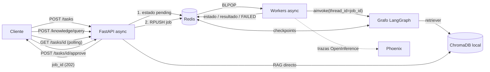
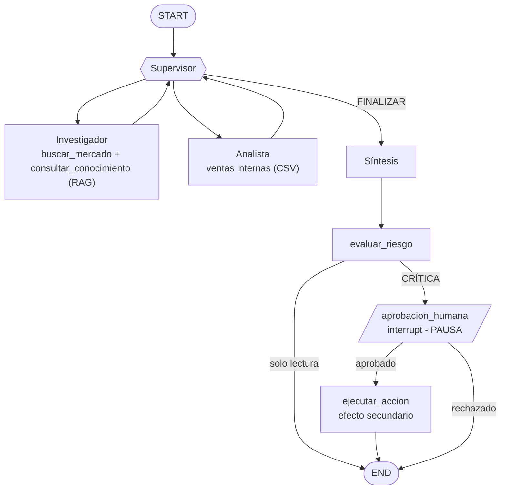
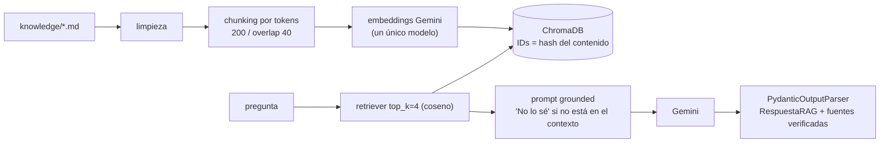
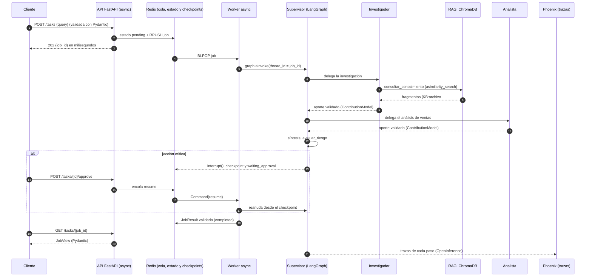
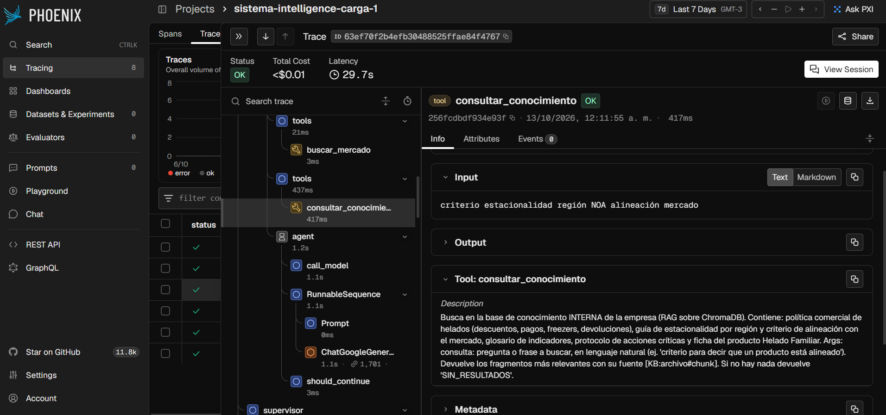
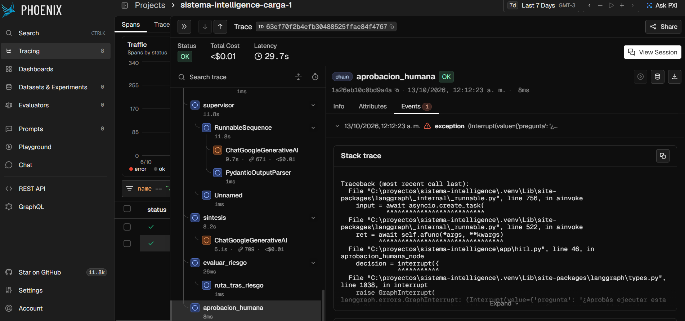
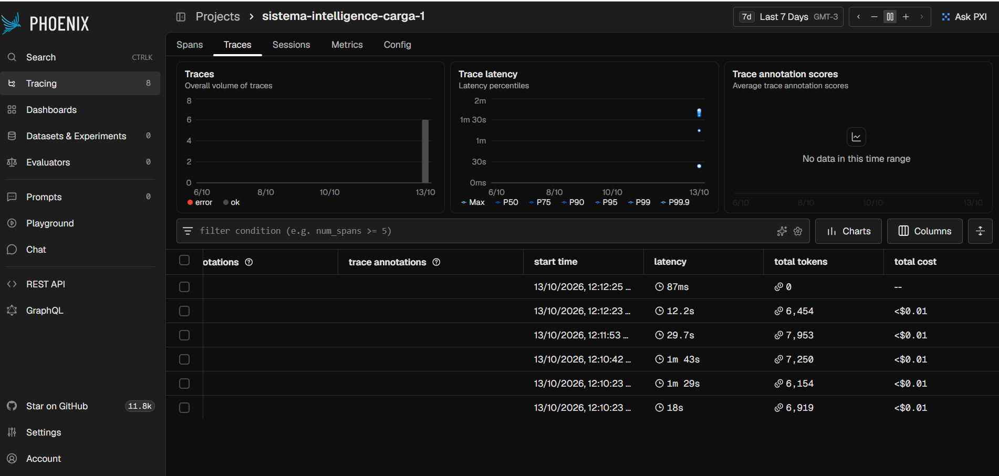
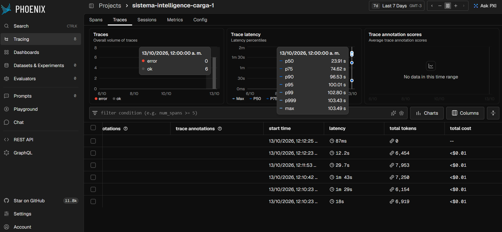

# Sistema Intelligence de grado de producción

**RAG (ChromaDB) + agentes con Supervisor (LangGraph) + API asíncrona (FastAPI + Redis) + Human-in-the-loop + trazabilidad (Arize Phoenix).**

Un usuario (o un proceso automatizado) envía una tarea compleja, por ejemplo *"Investigá la estacionalidad de los helados, buscá en nuestra guía interna el criterio de alineación con el mercado y analizá Helado Familiar en el Centro"*. El sistema:

1. **Acceso a conocimiento específico (RAG):** el agente Investigador consulta la base de conocimiento interna (política comercial, guía de estacionalidad, glosario, protocolo de acciones críticas, ficha de producto) indexada en ChromaDB, además del mercado.
2. **Razonamiento multi-paso (agentes):** un Supervisor delega en el Investigador y el Analista (ventas internas) y redacta la síntesis.
3. **API profesional y documentada:** `POST /tasks` encola y responde al instante con un `job_id`; documentación interactiva en `/docs`.
4. **Trazabilidad completa:** cada job genera una traza en Phoenix con agentes, herramientas, retriever (fragmentos recuperados), tokens, costo y latencia.

## Arquitectura







## Flujo end-to-end (de la petición a la respuesta)



**Rol de cada capa**

- **API (`app/api.py`):** recibe y valida la petición, encola y responde sin bloquear. Es la única puerta de entrada (tareas y consulta directa al RAG).
- **Cola y workers (`app/worker.py`, Redis):** desacoplan la API de las ejecuciones largas del LLM; cualquier excepción deja el job en `FAILED`.
- **Supervisor (`app/agents/supervisor.py`):** decide qué especialista interviene y cuándo terminar, con salida estructurada (`RouteDecision`) y guardas deterministas (tope de pasos y de visitas).
- **Agentes especialistas:** el Investigador usa dos herramientas (mercado y **RAG**); el Analista calcula sobre las ventas internas. Ambos reciben solo el contexto que necesitan.
- **RAG (`app/rag/`):** ingesta, recuperación y generación con "No lo sé"; está expuesto como herramienta del Investigador y como endpoint propio.
- **Checkpointer (`app/redis_checkpointer.py`):** guarda el estado de cada hilo en Redis, y por eso el flujo se puede pausar (HITL) y reanudar aunque la API se reinicie.
- **Observabilidad (`app/observability.py`):** Phoenix recibe una traza por ejecución con agentes, herramientas, retriever, tokens, costo y latencia.

## Estructura

| Ruta | Para qué sirve |
|---|---|
| `app/api.py` | API FastAPI: `/tasks`, `/tasks/{id}`, `/tasks/{id}/approve`, `/knowledge/query`, `/status/{id}`, `/health`. |
| `app/rag/store.py` | Ingesta (carga, limpieza, chunking, IDs deterministas) y recuperación async sobre ChromaDB. |
| `app/rag/chain.py` | Cadena RAG (LCEL) con prompt grounded, `PydanticOutputParser` y verificación de fuentes. |
| `app/rag/models.py` | Contratos Pydantic: `ConsultaConocimiento`, `FragmentoRecuperado`, `RespuestaRAG`. |
| `app/agents/` | Supervisor, Investigador (mercado + RAG) y Analista (ventas). |
| `app/schemas.py` | Contratos Pydantic: respuestas de la API, aportes y decisiones del estado compartido, resultado del job y argumentos de cada herramienta. |
| `app/graph.py`, `app/state.py` | Grafo jerárquico de LangGraph y estado compartido (reducers). |
| `app/hitl.py` | Detección de tareas críticas, nodo `interrupt()` y ejecución de la acción aprobada. |
| `app/worker.py`, `app/jobs.py` | Workers asíncronos (`BLPOP`) y estado de jobs en Redis (`FAILED` ante cualquier excepción). |
| `app/redis_checkpointer.py` | Checkpointer de LangGraph sobre Redis: el estado de cada hilo sobrevive a reinicios. |
| `app/observability.py` | Arize Phoenix (`OBSERVABILITY=phoenix`) o LangSmith. |
| `knowledge/` | Documentos de la base de conocimiento (ficticios, caso helados). |
| `data/` | Ventas internas (CSV) y notas de mercado (JSON), ficticias. |
| `scripts/load_test.py` | Prueba de carga: 5 peticiones concurrentes. |
| `tests/` | 27 pruebas offline (fakeredis, embeddings y modelos simulados). |
| `Dockerfile`, `docker-compose.yml` | Despliegue local: solo Redis, o todo el sistema con `--profile full`. |

## Cómo correrlo (Windows PowerShell)

Requisitos: **Python 3.12 o superior**, Docker Desktop (para Redis) y una `GOOGLE_API_KEY` de Gemini en tu `.env`. Phoenix corre local, sin cuenta.

```powershell
# 1) Entorno e instalación
python -m venv .venv
.\.venv\Scripts\Activate.ps1
pip install -r requirements.txt
copy .env.example .env        # completá GOOGLE_API_KEY (lo demás ya viene configurado)

# 2) Redis (abrí Docker Desktop y esperá a que diga "running")
docker compose up -d
docker compose ps             # debe verse "healthy"

# 3) Phoenix (TERMINAL 2, con el venv activado) -> http://localhost:6006
phoenix serve

# 4) API (TERMINAL 1). La primera vez indexa knowledge/ en ChromaDB (unos segundos)
uvicorn app.api:app --port 8000
```

Al arrancar, la API muestra `Phoenix ACTIVO (proyecto: sistema-intelligence ...)`. Documentación interactiva: http://localhost:8000/docs.

### Alternativa: todo con Docker Compose

```powershell
# cerrá "phoenix serve" y "uvicorn" locales, y tené el .env completo
docker compose --profile full up -d --build
```

Levanta Redis, Phoenix (http://localhost:6006) y la API (http://localhost:8000) en contenedores; la base de ChromaDB persiste en un volumen. Para bajarlo: `docker compose --profile full down`.

### Consultar el RAG directamente

```powershell
$body = @{ pregunta = "¿Qué descuento corresponde a un pedido de 1000 cajas?" } | ConvertTo-Json
Invoke-RestMethod -Method Post -Uri http://localhost:8000/knowledge/query -ContentType "application/json; charset=utf-8" -Body ([System.Text.Encoding]::UTF8.GetBytes($body))
```

Devuelve `respuesta`, `encontrado_en_contexto` y `fuentes`. Si la pregunta no está en los documentos (por ejemplo, la capital de Australia), responde **"No lo sé"** y no cita fuentes.

### Lanzar una tarea multi-agente

```powershell
$body = @{ query = "Investigá la estacionalidad de los helados, buscá en nuestra guía interna el criterio de alineación con el mercado y analizá Helado Familiar en Centro entre enero y marzo" } | ConvertTo-Json
$r = Invoke-RestMethod -Method Post -Uri http://localhost:8000/tasks -ContentType "application/json; charset=utf-8" -Body ([System.Text.Encoding]::UTF8.GetBytes($body))
$r                                                          # devuelve el job_id al instante
Invoke-RestMethod http://localhost:8000/tasks/$($r.job_id)   # repetir hasta status = completed
```

### Human-in-the-loop (aprobación humana)

```powershell
# Consulta CRÍTICA (pide enviar un email): el job queda en "waiting_approval"
$body = @{ query = "Investigá helados en el NOA, analizá Helado Familiar y enviá el resumen por email a gerencia" } | ConvertTo-Json
$r = Invoke-RestMethod -Method Post -Uri http://localhost:8000/tasks -ContentType "application/json; charset=utf-8" -Body ([System.Text.Encoding]::UTF8.GetBytes($body))
Invoke-RestMethod http://localhost:8000/tasks/$($r.job_id)   # status: waiting_approval + accion_propuesta

# Aprobar (aprobado = $true) o rechazar ($false: la acción NO se ejecuta)
Invoke-RestMethod -Method Post -Uri http://localhost:8000/tasks/$($r.job_id)/approve -ContentType "application/json" -Body '{"aprobado": true}'
```

Como el checkpoint vive en Redis, podés **reiniciar la API** mientras el job espera y aprobarlo igual.

### Prueba de carga (5 peticiones concurrentes)

```powershell
python scripts/load_test.py --auto-approve
```

Luego abrí http://localhost:6006 → proyecto `sistema-intelligence` → pestaña **Traces** y sacá las capturas indicadas en `screenshots/README.md`.

### Tests

```powershell
python -m pytest -q                                   # offline: fakeredis + embeddings y modelos simulados
$env:TEST_REDIS_URL="redis://localhost:6379/15"; python -m pytest -q   # incluye la prueba de reinicio con Redis real
```

## Resultados y trazas (evidencia de ejecución real)

Prueba de carga con `python scripts/load_test.py --auto-approve`: 5 peticiones concurrentes (`WORKER_CONCURRENCY=2`, Gemini plan gratuito), trazas en el proyecto de Phoenix `sistema-intelligence-carga-1`.

- Los 5 jobs se encolaron en 0,37 s (la API no se bloquea) y terminaron en `completed`; uno fue crítico y pasó por la aprobación humana (traza `job-resume`).
- Latencia vista por el cliente (incluye la espera en cola): media 97,3 s, p95 132,6 s, máx 132,6 s.
- Latencia en Phoenix (solo ejecución, sin cola): P50 23,9 s, P95 100,0 s, máx 103,5 s. La diferencia se debe a que con 2 workers los jobs 3, 4 y 5 esperan turno y a los reintentos por el límite del plan gratuito.
- 6 trazas, todas con estado OK, costo `<$0.01` por ejecución y entre 6.154 y 7.953 tokens.
- Una consulta de ejemplo usó `buscar_mercado` y `consultar_conocimiento`, y su respuesta citó `[M-01]` y `[KB:02_guia_estacionalidad_y_regiones.md#4]`.
- También se verificó el despliegue completo con `docker compose --profile full up -d --build`: API, Phoenix y Redis arriba, y `/knowledge/query` respondiendo desde el contenedor con embeddings reales.

**Traza con RAG:** jerarquía supervisor, agentes y herramientas; se ve `consultar_conocimiento` con su entrada y su descripción.



**Human-in-the-loop:** el span `aprobacion_humana` registra el `Interrupt` en el que el grafo se pausa esperando la aprobación.



**Costo y tokens por ejecución:**



**Latencia (P50, P95, P99, máx):**



## Evidencia por criterio de la rúbrica

### 1. Arquitectura y coherencia del sistema (30 %)

Las capas de los módulos anteriores forman un único flujo (ver el diagrama de secuencia de arriba): API (módulo 7) → cola Redis → Supervisor y agentes (módulo 6) → herramienta RAG (módulo 3) → LLM → respuesta validada.

| Qué se evalúa | Dónde está |
|---|---|
| Un solo punto de entrada que recibe la tarea y devuelve un `job_id` | [`app/api.py`](app/api.py) (`create_task`) |
| Supervisor que delega y decide cuándo terminar | [`app/agents/supervisor.py`](app/agents/supervisor.py) (`crear_nodo_supervisor`, `aplicar_guardas`) |
| El RAG se invoca desde el agente Investigador, dentro del grafo | [`app/agents/research_agent.py`](app/agents/research_agent.py) (`consultar_conocimiento`) y [`app/rag/store.py`](app/rag/store.py) (`buscar_fragmentos`) |
| Grafo que ensambla supervisor, agentes, síntesis, control de riesgo y HITL | [`app/graph.py`](app/graph.py) (`construir_grafo`) |
| Prueba de que el Investigador usa el RAG dentro del grafo completo | [`tests/test_rag.py`](tests/test_rag.py) (`test_el_investigador_usa_el_rag_dentro_del_grafo`) |

### 2. Robustez técnica: asincronía y validación (25 %)

**Async de extremo a extremo (Python 3.12):**

- Endpoints `async def` ([`app/api.py`](app/api.py)); workers con `BLPOP` asíncrono y `asyncio.wait_for` como timeout por job ([`app/worker.py`](app/worker.py)).
- Grafo invocado con `await graph.ainvoke(...)`; nodos y herramientas `async def`; LLM con `ainvoke` y recuperación con `asimilarity_search_with_score` ([`app/rag/store.py`](app/rag/store.py)).
- Redis con `redis.asyncio`, también en el checkpointer. Cliente HTTP de los tests: `httpx.AsyncClient`.
- No hay `requests` ni llamadas bloqueantes dentro de `async def`: lo que es síncrono por naturaleza (ChromaDB, lectura del CSV y del JSON) se ejecuta con `asyncio.to_thread`. Los workers corren en paralelo con `asyncio.create_task` y se cierran con `asyncio.gather`.

**Validación con Pydantic v2 (todo en [`app/schemas.py`](app/schemas.py) y [`app/rag/models.py`](app/rag/models.py)):**

| Capa | Modelo |
|---|---|
| Entrada de la API | `TaskRequest`, `ApprovalRequest`, `ConsultaConocimiento` (largo mínimo y máximo) |
| Respuesta de la API (`response_model`) | `TaskCreated`, `JobView`, `HealthView`, `RespuestaRAG` |
| Estado compartido del grafo | `ContributionModel` y `DecisionModel`: cada nodo valida lo que escribe en `OrchestratorState` |
| Decisión del supervisor (salida estructurada del LLM) | `RouteDecision` con `with_structured_output` |
| Resultado final del job | `JobResult`, validado antes de guardarse en Redis |
| Argumentos de cada herramienta | `args_schema` con `BuscarMercadoArgs`, `ConsultarConocimientoArgs`, `VentasPorMesArgs`, `CalcularVariacionArgs` |
| Validadores personalizados | `RespuestaRAG` (`@model_validator`: sin contexto responde "No lo sé" y sin fuentes) y `VentasPorMesArgs` (`@field_validator`) |

Pruebas: [`tests/test_schemas.py`](tests/test_schemas.py), [`tests/test_rag.py`](tests/test_rag.py) y [`tests/test_api.py`](tests/test_api.py).

### 3. Persistencia (checkpointers de LangGraph) y observabilidad (20 %)

**Checkpointer.** El grafo se compila con un checkpointer ([`app/graph.py`](app/graph.py)): `builder.compile(checkpointer=checkpointer)`. Se usa `AsyncRedisCheckpointer`, una implementación propia de `BaseCheckpointSaver` de LangGraph ([`app/redis_checkpointer.py`](app/redis_checkpointer.py)) con comandos básicos de Redis, para no depender de módulos extra (RedisJSON / RediSearch) y funcionar con un `redis:7` común.

```python
# app/observability.py: cada ejecución del grafo usa el job_id como thread_id
config = {"configurable": {"thread_id": job_id}, ...}
await graph.ainvoke(entrada, config)   # app/worker.py
```

- **Continuidad:** el estado del hilo se guarda en cada paso. Con la acción crítica el grafo se pausa con `interrupt()` y se reanuda con `Command(resume=...)` usando el mismo `thread_id`, incluso con un checkpointer nuevo o después de reiniciar la API.
- **Pruebas:** [`tests/test_checkpointer.py`](tests/test_checkpointer.py) (`test_pausa_y_reanuda_con_un_checkpointer_nuevo`, `test_hilos_aislados_y_borrado`) y [`tests/test_api.py`](tests/test_api.py) (`test_el_estado_sobrevive_al_reinicio_de_la_api`).
- **Estado de los jobs** en Redis, con `FAILED` ante cualquier excepción ([`app/jobs.py`](app/jobs.py)).

**Observabilidad con herramienta externa (Arize Phoenix, local).** Con `OBSERVABILITY=phoenix` se instrumenta LangChain/LangGraph con OpenInference ([`app/observability.py`](app/observability.py)). Cada ejecución registra entradas y salidas de cada nodo, llamadas a herramientas con argumentos y retorno, tokens, costo y latencia por llamada. LangSmith queda como alternativa configurable. La evidencia real está en la sección *Resultados y trazas*.

### 4. Documentación y despliegue (15 %)

- Este README: tres diagramas de arquitectura, el diagrama de secuencia, el rol de cada capa, los pasos de ejecución en PowerShell y la evidencia por criterio.
- [`docker-compose.yml`](docker-compose.yml): Redis solo (`docker compose up -d`) o todo el sistema con `docker compose --profile full up -d --build`. [`Dockerfile`](Dockerfile) basado en `python:3.12-slim`. Ambos fueron verificados.
- Documentación interactiva de la API en `/docs` (OpenAPI generado desde los modelos Pydantic).

### 5. Entorno y estándares (10 %)

- Python 3.12 ([`.python-version`](.python-version)) y dependencias en [`requirements.txt`](requirements.txt).
- Toda la configuración sale de variables de entorno ([`app/config.py`](app/config.py) y [`.env.example`](.env.example)): modelos, rutas, colección de ChromaDB, `top_k`, concurrencia, reintentos y observabilidad. No hay claves, IDs ni nombres de modelos fijos en el código.
- `.env`, `.venv` y `vectorstore/` están en el `.gitignore`.

## Notas de diseño

- **Un solo modelo de embeddings:** se registra como metadato de la colección; si cambia, la app avisa y pide `python -m app.rag.ingest --reset` (error clásico de RAG).
- **IDs deterministas:** reindexar no duplica chunks (hash del origen + contenido).
- **Generación grounded:** el prompt obliga a responder solo con el contexto y a decir "No lo sé" si no está; las fuentes citadas se verifican contra lo realmente recuperado.
- **Reintentos de Gemini:** el modelo usa `max_retries` alto y `WORKER_CONCURRENCY` bajo para tolerar el límite por minuto del plan gratuito. Las latencias de la prueba de carga incluyen esas esperas.
- **Sin efectos antes del `interrupt()`:** al reanudar, el nodo se re-ejecuta desde el principio; la acción real vive en el nodo siguiente.
- **Los documentos de `knowledge/` y `data/` son ficticios** y sirven solo para la demostración.
