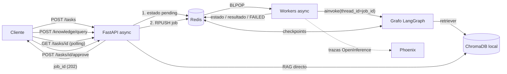
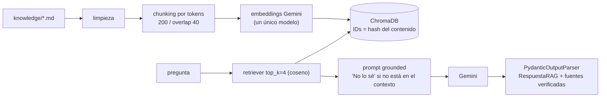

# Sistema Intelligence de grado de producción

**RAG (ChromaDB) + agentes con Supervisor (LangGraph) + API asíncrona (FastAPI + Redis) + Human-in-the-loop + trazabilidad (Arize Phoenix).**

Un usuario (o un proceso automatizado) envía una tarea compleja, por ejemplo *"Investigá la estacionalidad de los helados, buscá en nuestra guía interna el criterio de alineación con el mercado y analizá Helado Familiar en el Centro"*. El sistema:

1. **Acceso a conocimiento específico (RAG):** el agente Investigador consulta la base de conocimiento interna (política comercial, guía de estacionalidad, glosario, protocolo de acciones críticas, ficha de producto) indexada en ChromaDB, además del mercado.
2. **Razonamiento multi-paso (agentes):** un Supervisor delega en el Investigador y el Analista (ventas internas) y redacta la síntesis.
3. **API profesional y documentada:** `POST /tasks` encola y responde al instante con un `job_id`; documentación interactiva en `/docs`.
4. **Trazabilidad completa:** cada job genera una traza en Phoenix con agentes, herramientas, retriever (fragmentos recuperados), tokens, costo y latencia.

## Arquitectura






## Estructura

| Ruta | Para qué sirve |
|---|---|
| `app/api.py` | API FastAPI: `/tasks`, `/tasks/{id}`, `/tasks/{id}/approve`, `/knowledge/query`, `/status/{id}`, `/health`. |
| `app/rag/store.py` | Ingesta (carga, limpieza, chunking, IDs deterministas) y recuperación async sobre ChromaDB. |
| `app/rag/chain.py` | Cadena RAG (LCEL) con prompt grounded, `PydanticOutputParser` y verificación de fuentes. |
| `app/rag/models.py` | Contratos Pydantic: `ConsultaConocimiento`, `FragmentoRecuperado`, `RespuestaRAG`. |
| `app/agents/` | Supervisor, Investigador (mercado + RAG) y Analista (ventas). |
| `app/graph.py`, `app/state.py` | Grafo jerárquico de LangGraph y estado compartido (reducers). |
| `app/hitl.py` | Detección de tareas críticas, nodo `interrupt()` y ejecución de la acción aprobada. |
| `app/worker.py`, `app/jobs.py` | Workers asíncronos (`BLPOP`) y estado de jobs en Redis (`FAILED` ante cualquier excepción). |
| `app/redis_checkpointer.py` | Checkpointer de LangGraph sobre Redis: el estado de cada hilo sobrevive a reinicios. |
| `app/observability.py` | Arize Phoenix (`OBSERVABILITY=phoenix`) o LangSmith. |
| `knowledge/` | Documentos de la base de conocimiento (ficticios, caso helados). |
| `data/` | Ventas internas (CSV) y notas de mercado (JSON), ficticias. |
| `scripts/load_test.py` | Prueba de carga: 5 peticiones concurrentes. |
| `tests/` | 22 pruebas offline (fakeredis, embeddings y modelos simulados). |
| `Dockerfile`, `docker-compose.yml` | Despliegue local: solo Redis, o todo el sistema con `--profile full`. |

## Cómo correrlo (Windows PowerShell)

Requisitos: **Python 3.12 o superior**, Docker Desktop (para Redis) y una `GOOGLE_API_KEY` de Gemini en tu `.env`. Phoenix corre local, sin cuenta.

```powershell
# 1) Entorno e instalación
python -m venv .venv
.\.venv\Scripts\Activate.ps1
pip install -r requirements.txt
copy .env.example .env        # completá GOOGLE_API_KEY (lo demás ya viene configurado)

# 2) Redis (abrí Docker Desktop y esperá a que diga "running")
docker compose up -d
docker compose ps             # debe verse "healthy"

# 3) Phoenix (TERMINAL 2, con el venv activado) -> http://localhost:6006
phoenix serve

# 4) API (TERMINAL 1). La primera vez indexa knowledge/ en ChromaDB (unos segundos)
uvicorn app.api:app --port 8000
```

Al arrancar, la API muestra `Phoenix ACTIVO (proyecto: sistema-intelligence ...)`. Documentación interactiva: http://localhost:8000/docs.

### Alternativa: todo con Docker Compose

```powershell
# cerrá "phoenix serve" y "uvicorn" locales, y tené el .env completo
docker compose --profile full up -d --build
```

Levanta Redis, Phoenix (http://localhost:6006) y la API (http://localhost:8000) en contenedores; la base de ChromaDB persiste en un volumen. Para bajarlo: `docker compose --profile full down`.

### Consultar el RAG directamente

```powershell
$body = @{ pregunta = "¿Qué descuento corresponde a un pedido de 1000 cajas?" } | ConvertTo-Json
Invoke-RestMethod -Method Post -Uri http://localhost:8000/knowledge/query -ContentType "application/json; charset=utf-8" -Body ([System.Text.Encoding]::UTF8.GetBytes($body))
```

Devuelve `respuesta`, `encontrado_en_contexto` y `fuentes`. Si la pregunta no está en los documentos (por ejemplo, la capital de Australia), responde **"No lo sé"** y no cita fuentes.

### Lanzar una tarea multi-agente

```powershell
$body = @{ query = "Investigá la estacionalidad de los helados, buscá en nuestra guía interna el criterio de alineación con el mercado y analizá Helado Familiar en Centro entre enero y marzo" } | ConvertTo-Json
$r = Invoke-RestMethod -Method Post -Uri http://localhost:8000/tasks -ContentType "application/json; charset=utf-8" -Body ([System.Text.Encoding]::UTF8.GetBytes($body))
$r                                                          # devuelve el job_id al instante
Invoke-RestMethod http://localhost:8000/tasks/$($r.job_id)   # repetir hasta status = completed
```

### Human-in-the-loop (aprobación humana)

```powershell
# Consulta CRÍTICA (pide enviar un email): el job queda en "waiting_approval"
$body = @{ query = "Investigá helados en el NOA, analizá Helado Familiar y enviá el resumen por email a gerencia" } | ConvertTo-Json
$r = Invoke-RestMethod -Method Post -Uri http://localhost:8000/tasks -ContentType "application/json; charset=utf-8" -Body ([System.Text.Encoding]::UTF8.GetBytes($body))
Invoke-RestMethod http://localhost:8000/tasks/$($r.job_id)   # status: waiting_approval + accion_propuesta

# Aprobar (aprobado = $true) o rechazar ($false: la acción NO se ejecuta)
Invoke-RestMethod -Method Post -Uri http://localhost:8000/tasks/$($r.job_id)/approve -ContentType "application/json" -Body '{"aprobado": true}'
```

Como el checkpoint vive en Redis, podés **reiniciar la API** mientras el job espera y aprobarlo igual.

### Prueba de carga (5 peticiones concurrentes)

```powershell
python scripts/load_test.py --auto-approve
```

Luego abrí http://localhost:6006 → proyecto `sistema-intelligence` → pestaña **Traces** y sacá las capturas indicadas en `screenshots/README.md`.

### Tests

```powershell
python -m pytest -q                                   # offline: fakeredis + embeddings y modelos simulados
$env:TEST_REDIS_URL="redis://localhost:6379/15"; python -m pytest -q   # incluye la prueba de reinicio con Redis real
```

## Mapa con la rúbrica

| Criterio | Dónde se cumple |
|---|---|
| **Arquitectura y coherencia (30%)** | Un único flujo: API → cola Redis → grafo LangGraph → Supervisor → Investigador (mercado + RAG) / Analista → síntesis → control de riesgo/HITL. El RAG es una herramienta del agente y también un endpoint propio. |
| **Robustez técnica: async y validación (25%)** | Todo `async/await`: endpoints, workers, `ainvoke`, recuperación (`asimilarity_search`) y la ingesta en un hilo (`asyncio.to_thread`); sin `requests` ni llamadas bloqueantes dentro de `async def`. Pydantic en entradas de la API, decisión del supervisor, fragmentos y `RespuestaRAG` (con validador de coherencia y verificación de fuentes). |
| **Persistencia y observabilidad (20%)** | Checkpointer de LangGraph sobre Redis (`thread_id = job_id`), estado de jobs en Redis con `FAILED` ante excepciones y trazas completas en Arize Phoenix (agentes, herramientas, retriever, tokens, costo, latencia). |
| **Documentación y despliegue (15%)** | Este README con tres diagramas de arquitectura, `docker-compose.yml` (Redis; o todo con `--profile full`), `Dockerfile` y pasos de ejecución para Windows PowerShell. |
| **Entorno y estándares (10%)** | Python 3.12 (`.python-version`), `requirements.txt`, configuración solo por variables de entorno (`.env.example`; modelos, rutas, colección y `top_k` sin valores fijos en el código) y `.env` fuera del repo. |

## Notas de diseño

- **Un solo modelo de embeddings:** se registra como metadato de la colección; si cambia, la app avisa y pide `python -m app.rag.ingest --reset` (error clásico de RAG).
- **IDs deterministas:** reindexar no duplica chunks (hash del origen + contenido).
- **Generación grounded:** el prompt obliga a responder solo con el contexto y a decir "No lo sé" si no está; las fuentes citadas se verifican contra lo realmente recuperado.
- **Reintentos de Gemini:** el modelo usa `max_retries` alto y `WORKER_CONCURRENCY` bajo para tolerar el límite por minuto del plan gratuito. Las latencias de la prueba de carga incluyen esas esperas.
- **Sin efectos antes del `interrupt()`:** al reanudar, el nodo se re-ejecuta desde el principio; la acción real vive en el nodo siguiente.
- **Los documentos de `knowledge/` y `data/` son ficticios** y sirven solo para la demostración.
